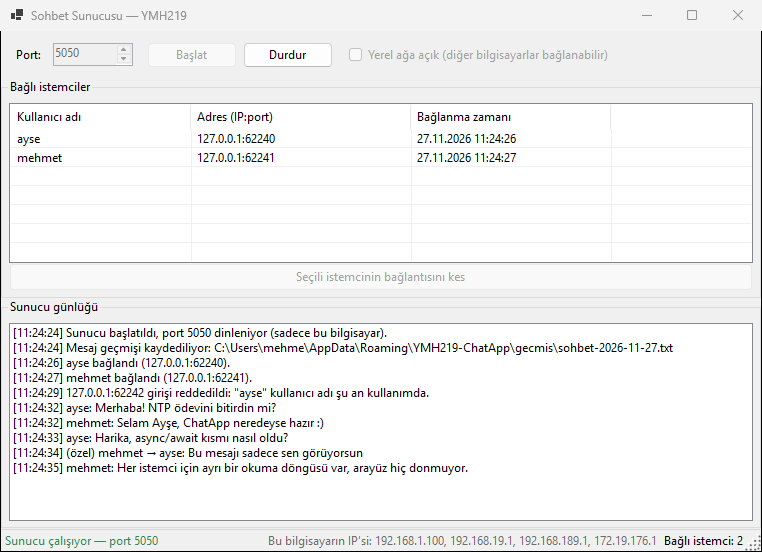
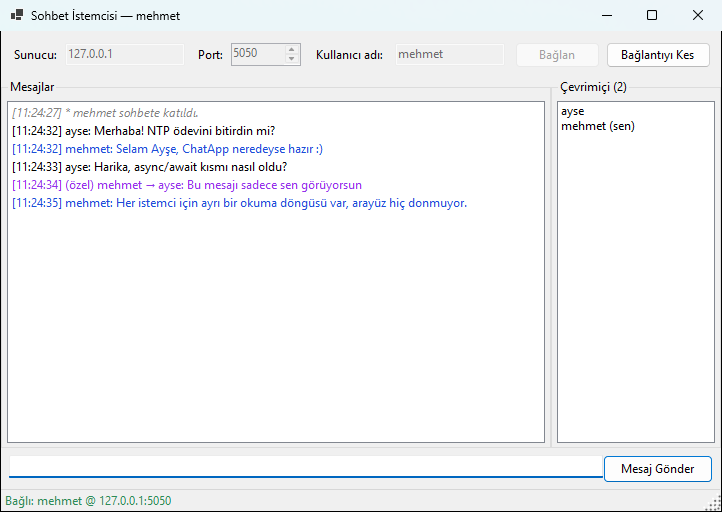
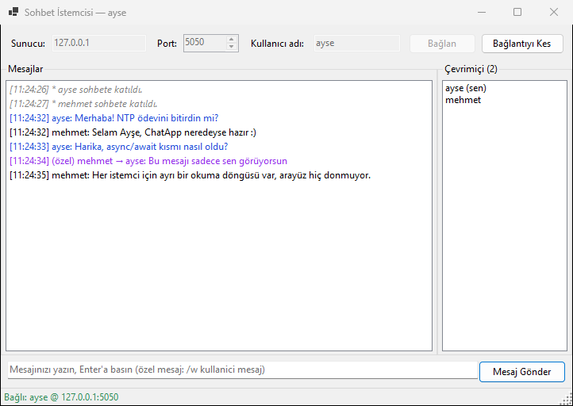
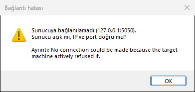

# YMH219-ChatApp — TCP Sohbet Uygulaması (Sunucu + İstemci)

`TcpListener` / `TcpClient` ile yazılmış, aynı bilgisayarda veya yerel ağda çalışan bir sohbet uygulaması.
Bir **sunucu** penceresi bağlantıları kabul eder; birden fazla **istemci** kullanıcı adıyla bağlanıp aynı odada mesajlaşır.
Tüm ağ işlemleri `async/await` ile yapılır, bu yüzden arayüz hiç donmaz.

> YMH 219 Nesne Tabanlı Programlama — Ek Uygulama Ödevi (Ağ Programlama: Chat Uygulaması)

## Ekran Görüntüleri

**Sunucu:** iki istemci bağlı (kullanıcı adı, IP:port, bağlanma zamanı) ve sunucu günlüğü.



**İstemci:** zaman bilgili mesajlar, özel mesaj (`/w`) ve çevrimiçi kullanıcılar.



| Diğer istemci (özel mesajı alan) | Sunucu kapalıyken bağlanma denemesi |
|---|---|
|  |  |

## Kullanılan Teknolojiler

- C# / .NET 10 — `ChatApp.Ortak` (`net10.0` sınıf kütüphanesi), `ChatApp.Sunucu` ve `ChatApp.Istemci` (`net10.0-windows` Windows Forms)
- `System.Net.Sockets`: `TcpListener`, `TcpClient`, `NetworkStream`
- `StreamReader` / `StreamWriter` ile satır tabanlı iletişim (her satır bir mesaj)
- `System.Text.Json` ile mesajların JSON'a çevrilmesi
- `async/await`, `CancellationToken`, `SemaphoreSlim` (aynı anda iki yazma olmasın diye)
- Harici NuGet paketi **kullanılmadı**.

## Kurulum ve Çalıştırma

Gereksinim: Windows ve [.NET 10 SDK](https://dotnet.microsoft.com/download) (ya da .NET masaüstü iş yükü kurulu Visual Studio).

```bash
git clone https://github.com/mehmet-furkan/YMH219-ChatApp.git
cd YMH219-ChatApp
dotnet build
```

**Çalıştırma sırası: önce sunucu, sonra istemciler.**

1. **Sunucu:** `dotnet run --project ChatApp.Sunucu` → port (varsayılan **5050**) → **Başlat**.
2. **İstemci(ler):** her istemci için ayrı bir terminalde `dotnet run --project ChatApp.Istemci` → sunucu IP'si, port ve kullanıcı adı → **Bağlan**.
   - Aynı bilgisayarda: sunucu adresi `127.0.0.1`.
   - Yerel ağdaki başka bir bilgisayardan: sunucu penceresinin alt çubuğunda yazan IP (ör. `192.168.1.100`).
3. Mesajı yazıp **Enter** veya **Mesaj Gönder**. Çıkmak için **Bağlantıyı Kes**.

**Visual Studio ile:** `YMH219-ChatApp.slnx` → Solution'a sağ tık → *Configure Startup Projects* → *Multiple startup projects* ile Sunucu ve İstemci'yi birlikte başlatın (önce Sunucu'da **Başlat**'a basın). İkinci istemci için `ChatApp.Istemci\bin\Debug\net10.0-windows\ChatApp.Istemci.exe` dosyasını bir kez daha açabilirsiniz.

> **Windows Güvenlik Duvarı:** Sunucu "Yerel ağa açık" seçeneğiyle başlatılınca Windows ilk seferde *"Bu uygulamanın ağlara erişmesine izin verilsin mi?"* diye sorar. Yerel ağdan bağlanılacaksa **Özel ağlar** için izin verin. Sadece aynı bilgisayarda deneyecekseniz "Yerel ağa açık" kutusunu kaldırın; sunucu yalnızca `127.0.0.1`'i dinler ve izin gerekmez.

## Temel Özellikler

**Sunucu**
- Port seçimi, **Başlat / Durdur**; port kullanımdaysa uygulama kapanmadan uyarı verir
- Bağlı istemciler `ListView`'de: **kullanıcı adı, IP:port, bağlanma zamanı**
- Sunucu günlüğü: bağlanan/ayrılan istemciler, reddedilen girişler, tüm mesajlar
- "Yerel ağa açık" seçeneği (kapalıyken sadece `127.0.0.1`) ve durum çubuğunda bu bilgisayarın IP adresleri
- Aynı kullanıcı adıyla ikinci girişi reddeder
- **Mesaj geçmişi** `%AppData%\YMH219-ChatApp\gecmis\sohbet-YYYY-AA-GG.txt` dosyasına kaydedilir

**İstemci**
- Sunucu IP, port ve **kullanıcı adı** ile **Bağlan**; **Bağlantıyı Kes**
- Gönderilen ve alınan her mesaj **zaman bilgisiyle** gösterilir: `[14:05:31] ayse: merhaba`
- Birden fazla istemci aynı odada (yayın); katılma/ayrılma bildirimleri
- **Özel mesaj:** `/w kullanici mesaj` (çevrimiçi listesinde bir kişiye çift tıklayınca komut hazırlanır)
- Çevrimiçi kullanıcı listesi
- **Bağlantı hataları uygulamayı kapatmaz:** sunucu yoksa / yanıt vermezse / kullanıcı adı alınmışsa uyarı penceresi; sohbet sırasında sunucu kapanırsa mesaj listesine ve durum çubuğuna yazılır, tekrar bağlanılabilir

## Nasıl Çalışır?

```
ChatApp.Ortak/                     (sunucu ve istemcinin ortak kullandığı kod)
  Models/Mesaj.cs                  → Tur, Gonderen, Alici, Metin, Zaman; fabrika metotları; ToString() = ekrandaki satır
  Models/MesajTuru.cs              → Giris, GirisKabul, GirisRed, Sohbet, Ozel, Sistem, KullaniciListesi, Cikis
  Ag/MesajProtokolu.cs             → Mesaj ⇄ tek satırlık JSON
  Ag/MesajBaglantisi.cs            → TcpClient + StreamReader/StreamWriter: GonderAsync / AlAsync
ChatApp.Sunucu/
  Models/BagliIstemci.cs           → kullanıcı adı, IP:port, bağlanma zamanı, bağlantı
  Services/SohbetSunucusu.cs       → TcpListener, kabul döngüsü, her istemci için okuma döngüsü, yayın, özel mesaj
  Services/MesajGecmisi.cs         → mesajları günlük .txt dosyasına ekler
  Services/AgBilgisi.cs            → bu bilgisayarın IPv4 adresleri
  AnaForm.cs                       → sadece arayüz: olaylara abone olur, listeyi ve günlüğü günceller
ChatApp.Istemci/
  Services/SohbetIstemcisi.cs      → TcpClient ile bağlanma, giriş, gönderme, arka planda dinleme
  Services/BaglantiHatasiException.cs → kullanıcıya gösterilecek bağlantı hatası
  AnaForm.cs                       → sadece arayüz
```

**Protokol:** TCP bir bayt akışıdır, mesaj sınırı yoktur. Bu yüzden her mesaj **tek satırlık JSON** olarak yazılır ve `\n` ile biter; karşı taraf `ReadLineAsync` ile bir satır = bir mesaj okur.

```json
{"Tur":"Sohbet","Gonderen":"ayse","Alici":null,"Metin":"merhaba","Zaman":"2026-11-27T14:05:31","Kullanicilar":null}
```

**Akış:** İstemci bağlanınca ilk mesaj olarak `Giris` gönderir → sunucu adı kontrol edip `GirisKabul` ya da `GirisRed` döner → sunucu herkese "katıldı" bildirimi ve güncel kullanıcı listesini yayınlar. Sonrasında istemcinin her `Sohbet` mesajı, gönderen adı ve zamanı **sunucu tarafından** belirlenerek (başkası adına mesaj atılamasın diye) bağlı tüm istemcilere gönderilir.

**Thread güvenliği:** Ağ olayları (mesaj geldi, istemci ayrıldı) arka plandaki async görevlerden gelebilir. Windows Forms kontrolleri yalnızca kendi (UI) thread'inden değiştirilebildiği için formlar `InvokeRequired` / `BeginInvoke` ile güncellemeyi UI thread'ine aktarır.

## Bilinen Sınırlamalar / Geliştirme Notları

- Tek bir sohbet odası vardır; oda/kanal sistemi yoktur.
- Bağlantı **şifrelenmez** (düz TCP); yalnızca güvenilir yerel ağda kullanım içindir. Kimlik doğrulama (parola) yoktur.
- Kullanıcı adı en fazla 20 karakter olabilir ve boşluk içeremez.
- İstemci tarafında mesaj geçmişi tutulmaz; geçmiş sunucuda kaydedilir.
- Sunucu kapanınca istemci otomatik yeniden bağlanmaz; kullanıcı **Bağlan**'a tekrar basmalıdır.
- Olası geliştirme: TLS (`SslStream`) ile şifreleme, birden fazla oda, dosya gönderme.

## Öğrenci

**Mehmet Furkan Akyar** — 240541056
